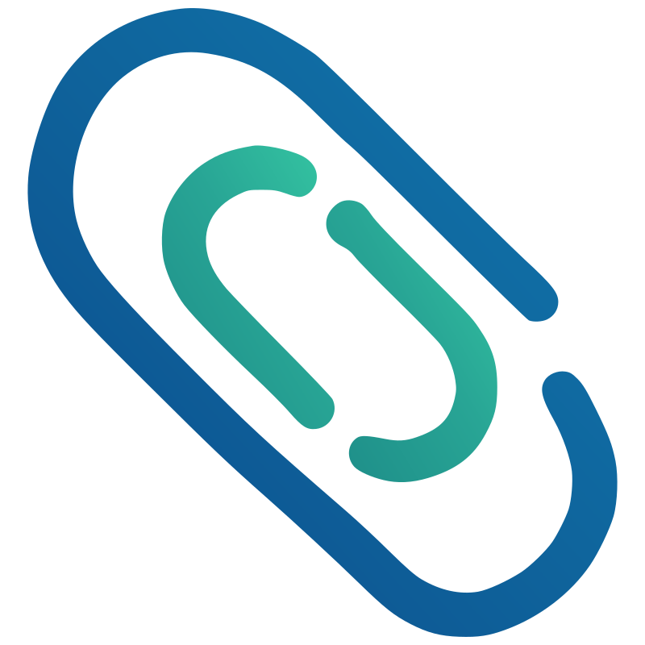

<p align="center">
  
</p>

# ZotClip

[](https://www.zotero.org)
[](https://github.com/kenanking/ZotClip/releases)
[](https://github.com/kenanking/ZotClip/blob/main/LICENSE)

ZotClip is a plugin for Zotero 8–11 with three feature areas. Zotero 11 has been
tested with 11.0-beta.4; see the [validation report](docs/validation.md).

- **Attachment clipboard copy** — from the library or reader, copy attachment
  files to the system clipboard. Target apps that accept file pastes receive
  files. If no file clipboard backend succeeds, ZotClip copies absolute paths
  as plain text. ZotClip cannot detect whether the eventual paste target accepts files.
- **AI tagging** — generate tags for selected library items using an
  OpenAI-compatible chat API. Built-in providers include DeepSeek, OpenRouter,
  Ollama, and LM Studio, plus a custom URL for other endpoints. Keys and prompts are
  configured in preferences.
- **Configuration backup, restore, and migration** — save portable settings,
  installed plug-ins, citation styles, translators, locate engines, and ZotClip
  AI keys in a `.zotclip` backup. Restore selected settings on the same computer
  or transfer them to another computer, with optional password encryption and
  a recovery copy saved before applying changes.

## Installation

Download the latest `.xpi` from
[GitHub Releases](https://github.com/kenanking/ZotClip/releases). In Zotero,
open `Tools -> Plugins`, click the gear button, choose `Install Plugin From
File...`, and select the downloaded package. Restart Zotero if the plugin does
not appear immediately.

## System Support

| System        | Clipboard backend                     | What to install                                 |
| ------------- | ------------------------------------- | ----------------------------------------------- |
| Windows 10/11 | Native `CF_HDROP` file copy           | Nothing extra                                   |
| Linux X11     | GTK4 helper backend                   | `python3-gi` and `gir1.2-gtk-4.0`               |
| Linux Wayland | `wl-copy` `text/uri-list` backend     | `wl-clipboard`                                  |
| macOS         | `osascript` AppKit pasteboard backend | Nothing extra; `osascript` is provided by macOS |

After installation, open `Edit -> Preferences -> ZotClip` and check the
`Compatibility` section. Confirm that `Backend diagnostics` reports the
expected backend for your system and does not show a missing dependency. If the
compatibility check does not pass, install the required system package before
retesting. AI tagging does not use these clipboard backends; it only needs
network access to your chosen API (or a local Ollama instance).

## Usage

### Attachment clipboard copy

In the library view, select an attachment or a parent item and press `Ctrl+C`,
or use `Copy Attachment File(s)` from the item context menu. The shortcut is
claimed only in the item list with a selection; unavailable attachments produce
a notification. Search fields, editable text, and the collections tree keep their
normal copy behavior.

Copies with duplicate filenames use private temporary files retained for the
current Zotero session, including plugin reloads. Old session files are removed
at the next Zotero startup. Paste while Zotero is still running.
On Windows, ZotClip restricts its cache directory to the current user, SYSTEM
and administrators using the bundled Windows PowerShell at session initialization.
Preparation stops if the cache cannot be secured.

In the reader, ZotClip keeps the default `Ctrl+C` behavior for text selection.
Use the reader toolbar button to copy the current attachment. If you want a
reader-specific shortcut, configure one in `Edit -> Preferences -> ZotClip`.

### AI tagging

In the library, select one or more regular items and choose **Generate AI Tags**
from the item context menu (when AI tagging is enabled in preferences). You can
also opt into automatic tagging for newly added items and optional stripping of
Connector-import tags; see preferences for details. A manual batch uses one compact
task card with progress, the current item, and a cancel button. Successful results dismiss after six seconds (hover or focus
keeps them visible). Failures stay visible with a button to retry only failed
items; repeated commands focus the existing task. Automatic successes are silent,
and automatic failures are summarized in the same card. Turning off AI tagging
also cancels queued and active tasks.
Completed changes are kept; cancelled requests cannot add tags. In Zotero 10+,
manual tag changes support the normal Undo/Redo commands (one item per step).
Background tagging does not add undo steps. Read-only and deleted items are skipped.

### Configuration backup, restore, and migration

Use this feature to back up your Zotero configuration before changing settings,
restore a saved setup, or move your configuration to another computer. All
options and the restore preview are part of **Preferences → ZotClip →
Configuration migration**; no separate configuration dialog is needed.

**Create a backup**

1. Open **Configuration migration** and select the content to include: portable
   settings, installed plug-ins, citation styles, translators, locate engines,
   and ZotClip AI keys.
2. Optionally check **Encrypt export with a password** and enter and confirm
   a password of at least 10 characters. Encryption is **off by default** and
   independent of the AI-key selection: keys can be backed up with or without
   encryption.
3. Export to a new `.zotclip` file and keep it for restoration or transfer.

Unencrypted backups contain any selected AI keys in readable form. Keep an
encrypted backup's password separately; ZotClip cannot recover it.

**Restore a backup or transfer it to another computer**

1. Install ZotClip on the destination computer if needed, then open the same
   **Configuration migration** section.
2. Choose **Open and preview** and select your `.zotclip` backup. Enter a
   password only if the file is encrypted.
3. Review the differences and select the settings and resources to restore.
   Map any selected local paths to existing paths on the destination computer.
4. Confirm the selected changes and choose where to save the recovery copy.
   ZotClip saves this copy of the previous state **before applying changes**.
5. Restart Zotero after restoration so the imported resources reload.

**Undo a restore**

Open the recovery copy through **Open and preview** to restore the previous
settings and resource files. Recovery copies use the imported backup's encryption
mode and password. Newly installed plug-ins may need manual removal; changes
made by third-party plug-ins themselves may also need manual cleanup.

The backup contains portable configuration. Library items and attachments are
not included.
Zotero sign-in/sync credentials, other plug-ins' login-manager credentials and
private databases are excluded. ZotClip itself and Zotero's bundled integration
plug-ins are not replaced. Existing newer plug-ins are skipped during normal
imports; compatibility checking cannot fix a third-party plug-in's runtime bugs.
Tara packages are not supported. See [migration format and scope](docs/configuration-migration.md).

### Notifications

Copy results and settings feedback share the AI task card styling, with the plugin
logo and no external shadow. Ordinary notifications update a single card alongside
any active task, can be closed manually, and pause automatic dismissal while
hovered or focused. Settings feedback appears in the main Zotero window.

## Settings (`Edit -> Preferences -> ZotClip`)

**Copying:** allowed attachment types, multi-attachment strategy, library and
reader shortcuts, toolbar and context menu visibility, platform clipboard
diagnostics.

**Configuration backup and restore:** choose backup contents, optionally encrypt
the export, preview a saved backup, select changes, map local paths, and save a
recovery copy before restoring. These controls are in **Configuration migration**
on the same settings page.

**AI tagging:** enable the feature, provider and model, API key and endpoint
(where applicable), optional connection test, and a prompt template with
`{title}`, `{abstract}`, and `{language}` placeholders.

API keys are saved explicitly in Zotero's login manager, separated by provider
and endpoint origin. The input is never prefilled with a saved key. Use **Save**
or **Delete** and check the status. Existing preference keys are migrated only
after successful storage verification; failed migrations retain the old value
for retry. Changing an endpoint to a different origin requires a key for that
origin. Prompts and other non-secret settings remain in preferences.

## Development

Install dependencies with `npm install`, then run `npm run start` for the local
development loop.

Before opening a PR, run:

- `npm run test:unit`
- `npm run build`
- `npm run lint:check`

`test:unit` runs without coverage instrumentation for fast iteration. Use
`npm run test:coverage` to run the same tests with coverage reporting. CI runs
coverage once and reuses one production build across the Zotero version matrix.

Pinned Linux integration runs (fresh isolated profiles, production XPI installation):

```sh
node scripts/test-zotero.mjs 8.0.4
node scripts/test-zotero.mjs 9.0.6
node scripts/test-zotero.mjs 10.0.1
node --import tsx scripts/test-clipboard-x11.ts
```

The integration runner builds a production XPI by default. To reuse an existing
build, set `ZOTCLIP_TEST_XPI` to its path outside `.scaffold/build`, which the test
scaffold overwrites.

The X11 test creates a separate Xvfb display and takes about a minute. Integration
logs are written to `.scaffold/validation/`. TypeScript remains pinned to 6.0.3.
See [`docs/validation.md`](docs/validation.md) for coverage and platform limits.

Manual verification notes live in [`docs/manual-testing.md`](docs/manual-testing.md).
